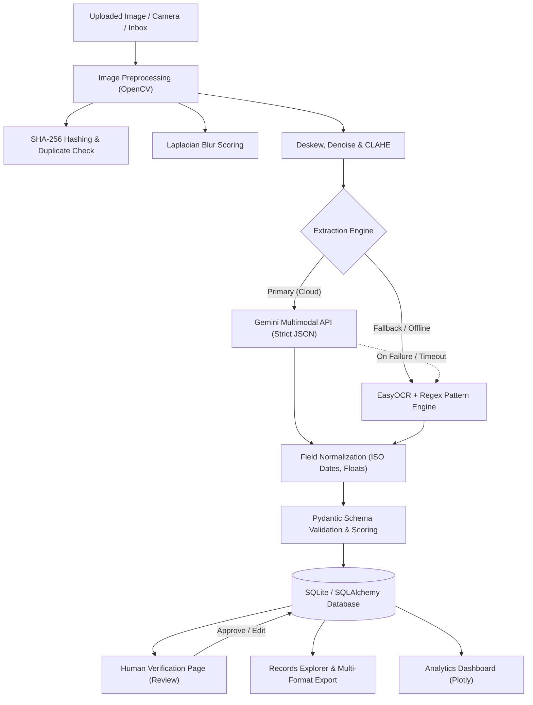

# SnapBase: Photo to Database Automation System

[](https://www.python.org/downloads/)
[](https://streamlit.io/)
[](https://www.sqlalchemy.org/)
[](https://opensource.org/licenses/MIT)

SnapBase is an enterprise-grade document extraction, validation, and database ingestion system. It converts unstructured photographs of receipts, invoices, student IDs, and tabular reports into strictly validated, typed relational records.

---

## 🌟 Key Features

1. **Multi-Source Ingestion**:
   - Single & batch file upload (`.jpg`, `.jpeg`, `.png`, `.webp` up to 10MB).
   - Real-time webcam snapshot capture.
   - Background directory watcher (`/inbox -> /processed` or `/failed`).
2. **Pluggable Dual Extraction Engine**:
   - **Gemini Vision Multimodal API** (`google-genai` SDK) returning strict schema JSON.
   - **Offline Local OCR** (`EasyOCR` + rule-based regex parsing), requiring zero external API keys.
   - Automated silent fallback from cloud vision to offline OCR upon transient network failure.
3. **Computer Vision Preprocessing**:
   - EXIF auto-rotation and deskewing via OpenCV minimum area bounding box.
   - Laplacian variance blur detection with real-time UI quality warnings.
   - Gaussian denoising and CLAHE (adaptive histogram equalization).
4. **Duplicate Prevention**:
   - SHA-256 cryptographic hashing blocks duplicate images and provides existing record links.
5. **Human-in-the-Loop Review**:
   - Side-by-side original photo inspection and live editable form.
   - Visual highlighting of low-confidence fields (< 70%).
   - Approve, Save Edits, and Reject workflows.
6. **Search & Multi-Format Export**:
   - Full-text search and filtering by document type, review status, and timestamp.
   - Export filtered datasets to **CSV**, **Excel (.xlsx)**, and **JSON** with a single click.
7. **Operational Analytics**:
   - Interactive Plotly visualizations (status distribution, volume by category, zero-edit automation accuracy).

---

## 🏗️ Architecture Diagram



---

## 🐍 Python Concepts Demonstrated

| Python Concept | Source File(s) | Architectural Purpose |
| :--- | :--- | :--- |
| **Object-Oriented Programming (OOP)** | [`core/extractor_base.py`](file:///c:/MY%20PROJECTS/Photo%20to%20database%20automation%20system/core/extractor_base.py), [`core/gemini_extractor.py`](file:///c:/MY%20PROJECTS/Photo%20to%20database%20automation%20system/core/gemini_extractor.py), [`core/ocr_extractor.py`](file:///c:/MY%20PROJECTS/Photo%20to%20database%20automation%20system/core/ocr_extractor.py) | Abstract base class (`abc.ABC`), polymorphic `extract()` method, and factory pattern instantiation. |
| **Pydantic Models & Data Typing** | [`core/validators.py`](file:///c:/MY%20PROJECTS/Photo%20to%20database%20automation%20system/core/validators.py), [`core/pipeline.py`](file:///c:/MY%20PROJECTS/Photo%20to%20database%20automation%20system/core/pipeline.py) | Schema definition contracts (`BaseModel`), dataclasses (`ProcessResult`), and confidence calculations. |
| **Custom Decorators** | [`core/decorators.py`](file:///c:/MY%20PROJECTS/Photo%20to%20database%20automation%20system/core/decorators.py) | `@timed` for latency logging and `@retry` with exponential backoff for network resilience. |
| **Context Managers** | [`db/session.py`](file:///c:/MY%20PROJECTS/Photo%20to%20database%20automation%20system/db/session.py) | `@contextmanager` providing transactional sessions with automatic commit/rollback. |
| **Generators (`yield`)** | [`core/pipeline.py`](file:///c:/MY%20PROJECTS/Photo%20to%20database%20automation%20system/core/pipeline.py) | Sequential batch document processing without memory bloat or UI thread lockup. |
| **Custom Exception Hierarchy** | [`core/exceptions.py`](file:///c:/MY%20PROJECTS/Photo%20to%20database%20automation%20system/core/exceptions.py) | `SnapBaseError` root with `ExtractionError`, `ValidationError`, and `DuplicateImageError`. |
| **Structured Logging** | [`config/settings.py`](file:///c:/MY%20PROJECTS/Photo%20to%20database%20automation%20system/config/settings.py) | Dual-target logging (rotating file + console) following 12-factor application standards (no `print()`). |
| **Functional Tools** | [`core/normalize.py`](file:///c:/MY%20PROJECTS/Photo%20to%20database%20automation%20system/core/normalize.py) | Dictionary comprehensions, regex transformations, and type dispatch dictionaries. |
| **Automated Testing** | [`tests/`](file:///c:/MY%20PROJECTS/Photo%20to%20database%20automation%20system/tests/) | `pytest` fixtures for in-memory SQLite isolation and `@pytest.mark.parametrize`. |

---

## 🚀 Setup & Execution

### 1. Prerequisites & Environment Setup

```bash
# Clone or navigate to the directory
cd "Photo to database automation system"

# Install dependencies
pip install -r requirements.txt
```

### 2. Environment Variables (.env)

Copy `.env.example` to `.env`:

```bash
cp .env.example .env
```

To enable Gemini Cloud Vision, set your API key in `.env`:
```env
GEMINI_API_KEY="your-api-key-here"
DEFAULT_ENGINE="gemini"
```
*(Note: If no API key is provided, SnapBase runs 100% locally with EasyOCR).*

### 3. Generate Sample Documents

```bash
python sample_data/generate_samples.py
```

### 4. Run the Streamlit Application

```bash
streamlit run app.py
```

The app will launch at `http://localhost:8501`.

### 5. Run the Automated Inbox Watcher

```bash
# Run one-off inbox processing
python watcher.py --once

# Or run continuous daemon
python watcher.py
```

### 6. Run Unit & Integration Tests

```bash
python -m pytest tests/ -v
```

---

## 🎨 Visual Design System

SnapBase uses a clean white background (`#FFFFFF`) with a black-to-red gradient top banner (`#111111` -> `#C62828`).
- **Accent Primary**: `#C62828` (Crimson Red)
- **Secondary**: `#111111` (Deep Black)
- **Background**: `#FFFFFF` (Pure White)
- **Status Badges**:
  - Green (`#2E7D32`): Approved & Processed
  - Amber (`#E65100`): Pending Review
  - Crimson (`#C62828`): Rejected
- **Cards**: Pure white background with `#E5E5E5` borders and soft drop shadows.

---

## 🔮 Future Enhancements

- Multi-language OCR expansion beyond English.
- Export directly to Google Sheets or QuickBooks via webhooks.
- Fine-tuned local layout detection model (e.g. LayoutLMv3).
