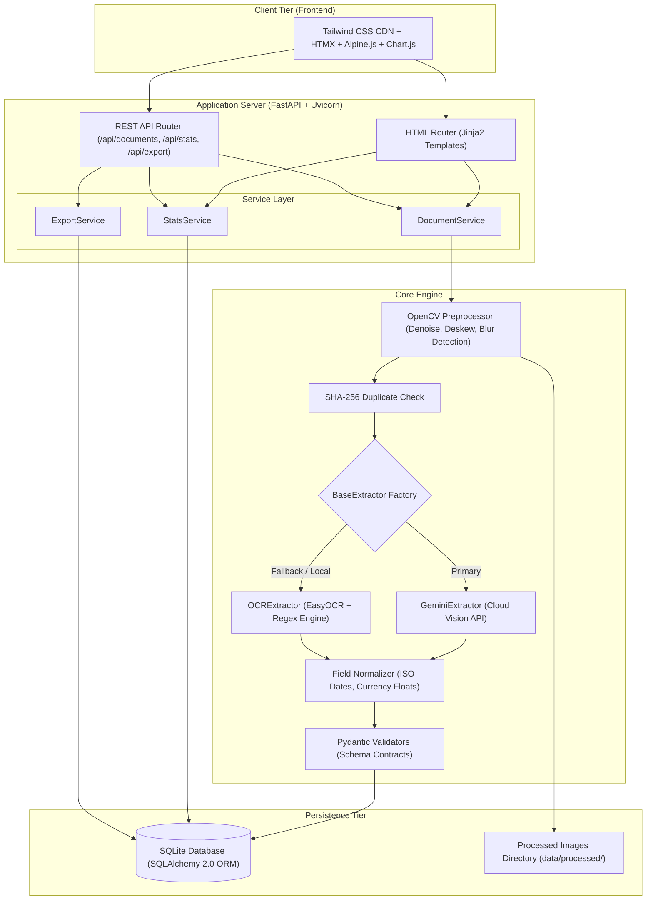

# SnapBase: Photo to Database Automation System

[](https://www.python.org/downloads/)
[](https://fastapi.tiangolo.com/)
[](https://www.sqlalchemy.org/)
[](https://opensource.org/licenses/MIT)

SnapBase is an enterprise-grade document extraction, validation, and database ingestion platform. Built on FastAPI, SQLAlchemy 2.0, Tailwind CSS, HTMX, and Alpine.js, it converts unstructured photographs of receipts, invoices, identity cards, and tabular reports into strictly validated, typed relational records with zero emojis and a professional design system.

---

## Key Features

1. **Multi-Source Document Ingestion**:
   - Single and batch drag-and-drop file upload (`.jpg`, `.jpeg`, `.png`, `.webp` up to 10MB) with per-file progress tracking.
   - Built-in webcam snapshot capture.
   - Background directory watcher (`/inbox -> /processed` or `/failed`).
2. **Pluggable Dual Extraction Architecture**:
   - **Google Gemini Multimodal AI** (`google-genai` SDK) returning strict schema JSON.
   - **Offline Local OCR** (`EasyOCR` + rule-based regex parsing) requiring zero external API keys.
   - Automated silent fallback from cloud vision to offline OCR upon transient network failure.
3. **Computer Vision Preprocessing Pipeline**:
   - EXIF auto-rotation and deskewing via OpenCV minimum area bounding box.
   - Laplacian variance blur detection with real-time UI quality warnings.
   - Gaussian denoising and CLAHE (contrast limited adaptive histogram equalization).
4. **Duplicate Prevention**:
   - SHA-256 cryptographic image hashing blocks duplicate uploads and provides instant references to existing records.
5. **Human-in-the-Loop Review & Verification**:
   - Split-screen verification: pannable and zoomable image viewer (zoom in/out, rotate 90 degrees) on the left, live editable form on the right.
   - Visual highlighting of low-confidence fields (< 70%) with confidence progress bars.
   - Keyboard shortcuts (`Ctrl+Enter` to approve, `Esc` to reject).
   - Editable line items table with add and remove row capabilities.
6. **Live Records Explorer & Multi-Format Export**:
   - HTMX-powered live search, multi-field filtering, and sortable columns.
   - Slide-over detail drawer for rapid document inspection.
   - Bulk selection with batch delete and export to **CSV**, **Excel (.xlsx)**, and **JSON**.
7. **Operational Analytics Dashboard**:
   - Responsive Chart.js visualizations (ingestion volume over time, document status split, schema breakdown).
   - Real-time KPI summary cards (Total Documents, Approved, Pending Review, Field Accuracy).

---

## Architecture



---

## Python Concepts Demonstrated

| Python Concept | Source File(s) | Architectural Purpose |
| :--- | :--- | :--- |
| **Object-Oriented Programming (OOP)** | [`core/extractor_base.py`](file:///c:/MY%20PROJECTS/Photo%20to%20database%20automation%20system/core/extractor_base.py), [`core/gemini_extractor.py`](file:///c:/MY%20PROJECTS/Photo%20to%20database%20automation%20system/core/gemini_extractor.py), [`core/ocr_extractor.py`](file:///c:/MY%20PROJECTS/Photo%20to%20database%20automation%20system/core/ocr_extractor.py) | Abstract base class (`abc.ABC`), polymorphic `extract()` method, and factory pattern instantiation. |
| **Pydantic Models & Data Typing** | [`core/validators.py`](file:///c:/MY%20PROJECTS/Photo%20to%20database%20automation%20system/core/validators.py), [`app/routers/api.py`](file:///c:/MY%20PROJECTS/Photo%20to%20database%20automation%20system/app/routers/api.py) | Schema definition contracts (`BaseModel`), dataclasses (`ProcessResult`), and confidence calculations. |
| **Service Layer Separation** | [`app/services/`](file:///c:/MY%20PROJECTS/Photo%20to%20database%20automation%20system/app/services/) | Separation of concerns: routers handle HTTP dispatching, services orchestrate business logic. |
| **Custom Decorators** | [`core/decorators.py`](file:///c:/MY%20PROJECTS/Photo%20to%20database%20automation%20system/core/decorators.py) | `@timed` for latency logging and `@retry` with exponential backoff for network resilience. |
| **Context Managers** | [`db/session.py`](file:///c:/MY%20PROJECTS/Photo%20to%20database%20automation%20system/db/session.py), [`app/dependencies.py`](file:///c:/MY%20PROJECTS/Photo%20to%20database%20automation%20system/app/dependencies.py) | `@contextmanager` providing transactional sessions with automatic commit/rollback. |
| **Generators (`yield`)** | [`core/pipeline.py`](file:///c:/MY%20PROJECTS/Photo%20to%20database%20automation%20system/core/pipeline.py) | Sequential batch document processing without memory bloat. |
| **Custom Exception Hierarchy** | [`core/exceptions.py`](file:///c:/MY%20PROJECTS/Photo%20to%20database%20automation%20system/core/exceptions.py) | `SnapBaseError` root with `ExtractionError`, `ValidationError`, and `DuplicateImageError`. |
| **Structured Logging** | [`config/settings.py`](file:///c:/MY%20PROJECTS/Photo%20to%20database%20automation%20system/config/settings.py) | Dual-target logging (rotating file + console) following 12-factor standards without raw `print()`. |
| **Functional Tools** | [`core/normalize.py`](file:///c:/MY%20PROJECTS/Photo%20to%20database%20automation%20system/core/normalize.py) | Dictionary comprehensions, regex transformations, and type dispatch mappings. |
| **Automated Testing** | [`tests/`](file:///c:/MY%20PROJECTS/Photo%20to%20database%20automation%20system/tests/) | 48 automated tests covering CRUD, normalization, validation, pipeline, and FastAPI endpoints. |

---

## REST API Overview

Interactive Swagger documentation is available at `http://localhost:8000/docs`.

| Method | Endpoint | Description |
| :--- | :--- | :--- |
| `POST` | `/api/documents` | Ingest and process one or multiple image uploads. |
| `GET` | `/api/documents` | Search, filter by type/status, sort, and paginate documents. |
| `GET` | `/api/documents/{id}` | Retrieve full details and extracted fields for a document. |
| `PATCH` | `/api/documents/{id}` | Update extracted key-value fields for a document. |
| `POST` | `/api/documents/{id}/approve` | Mark document status as approved/processed. |
| `POST` | `/api/documents/{id}/reject` | Mark document status as rejected. |
| `DELETE` | `/api/documents/{id}` | Permanently delete document record and stored image. |
| `GET` | `/api/stats` | Retrieve operational metrics, KPI totals, and chart history. |
| `GET` | `/api/export` | Stream dataset export in `csv`, `xlsx`, or `json` formats. |

---

## Setup & Execution

### 1. Prerequisites & Environment Setup

```bash
# Clone or navigate to the directory
cd "Photo to database automation system"

# Install dependencies
pip install -r requirements.txt
```

### 2. Configure Environment Variables (.env)

```bash
cp .env.example .env
```

To enable Gemini Cloud Vision, configure your key in `.env`:
```env
GEMINI_API_KEY="your-gemini-api-key"
DEFAULT_ENGINE="gemini"
```
*(Note: If no API key is provided, SnapBase runs 100% locally with EasyOCR without error).*

### 3. Generate Sample Documents

```bash
python sample_data/generate_samples.py
```

### 4. Run the Web Application

```bash
uvicorn app.main:app --reload
```

The portal will be accessible at `http://localhost:8000`.

### 5. Run the Automated Inbox Watcher

```bash
# Process all currently queued files once
python watcher.py --once

# Or run continuous background watcher
python watcher.py
```

### 6. Run Unit & Integration Tests

```bash
python -m pytest tests/ -v
```

All 48 tests will execute and pass without error.

---

## Visual Design System

SnapBase implements a clean, accessible SaaS design language:
- **Font**: Inter (Google Fonts).
- **Background**: Pure white (`#FFFFFF`) with soft gray surface cards (`#F9FAFB`).
- **Typography**: Near-black (`#111827`) and muted neutral grays (`#4B5563`, `#6B7280`).
- **Brand Accent**: One crimson red accent (`#C62828`) reserved for primary buttons, active navigation indicators, and key highlights.
- **Top / Header Bar**: Deep black (`#111111`) header contrast.
- **Icons**: Clean Lucide SVG icons (`data-lucide="..."`), strictly avoiding emojis.
- **Status Badges**:
  - Green (`bg-emerald-50 text-emerald-700`): Approved / Processed
  - Amber (`bg-amber-50 text-amber-700`): Pending Verification
  - Red (`bg-rose-50 text-rose-700`): Rejected
