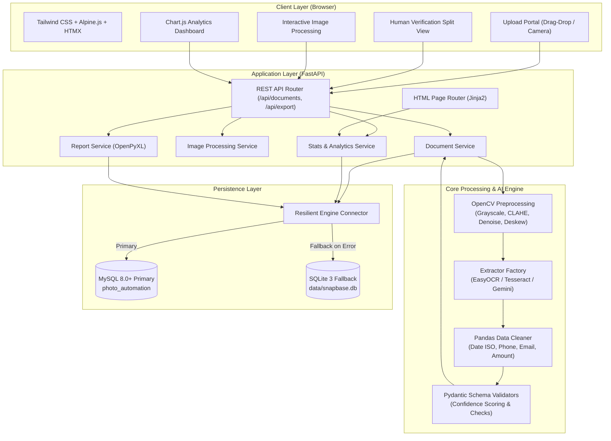
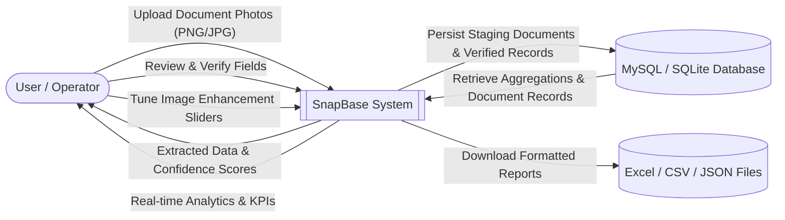
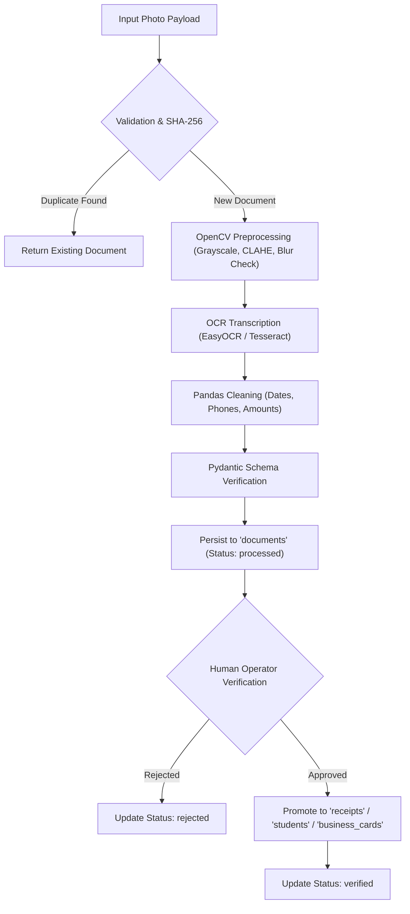
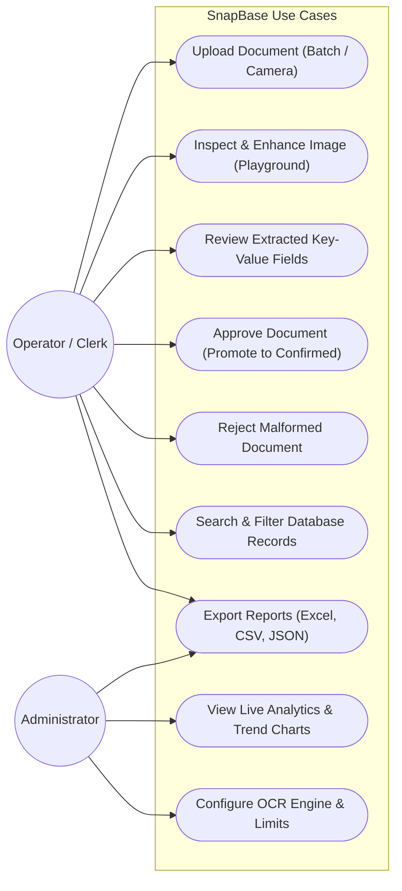
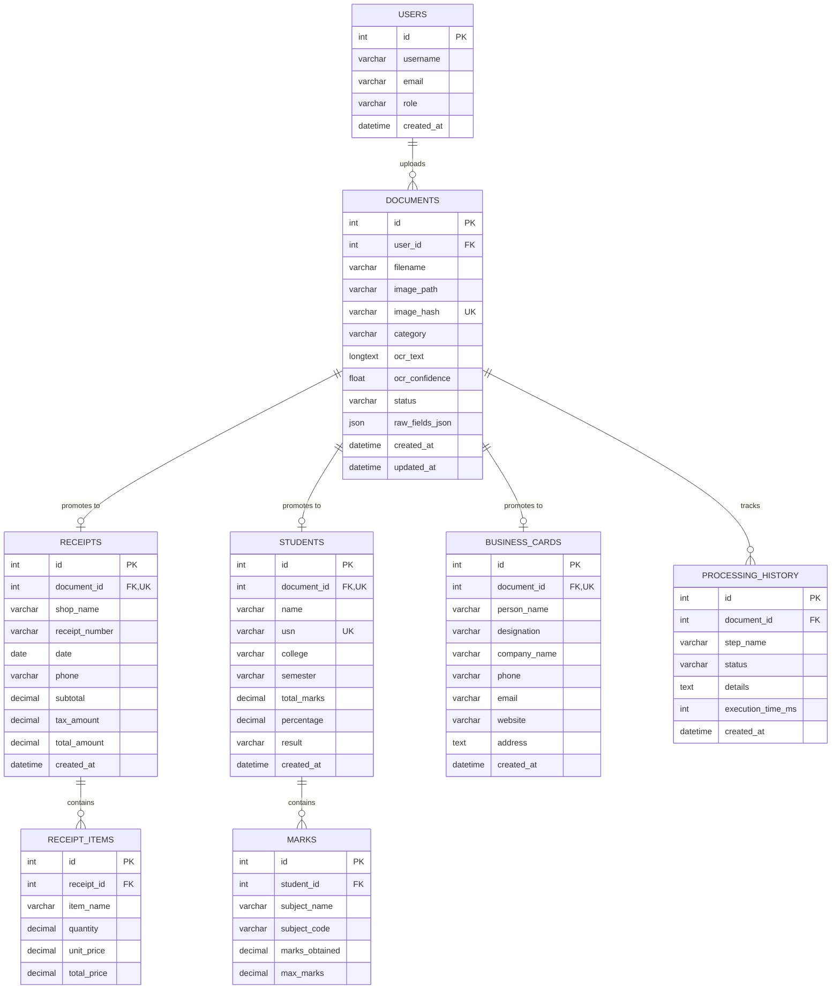

# SnapBase: Photo-to-Database Automation System
## Comprehensive Technical System Documentation & Project Report

---

### Abstract
Modern organizations, retail establishments, and educational institutions process thousands of physical documents daily, including expense receipts, student marksheets, and business cards. Traditional manual entry is error-prone, labor-intensive, and introduces significant latency into organizational databases. **SnapBase** is an enterprise-grade automated photo-to-database document intake platform developed using FastAPI, SQLAlchemy 2.0, EasyOCR/Tesseract, and OpenCV. SnapBase incorporates computer vision preprocessing, deep-learning optical character recognition, automated Pandas data cleaning, and human-in-the-loop verification. It operates on a primary MySQL 8.0+ relational backend with zero-downtime automatic fallback to local SQLite. A key architectural principle of SnapBase is data integrity: unverified OCR output is never saved directly into business tables. Instead, extracted data remains in a staging state until verified and promoted by authorized personnel.

---

### 1. Introduction
The digital transformation of paper documents bridges physical paperwork with structured enterprise databases. While cloud document AI APIs exist, they often present prohibitive subscription costs, data privacy concerns, and strict vendor lock-in. SnapBase delivers a self-hosted, scalable, and responsive solution capable of running on-premises or within enterprise cloud containers.

SnapBase was built with high performance and accessibility in mind, utilizing a modern decoupled stack:
- **Backend:** FastAPI, Python 3.11+, SQLAlchemy 2.0 ORM, and Pydantic validation.
- **Frontend:** Server-rendered Jinja2 templates, styled with Tailwind CSS, reactive HTMX for seamless partial page updates, Alpine.js for lightweight UI state, and Chart.js for data visualization.
- **Computer Vision & OCR:** OpenCV preprocessing pipeline, EasyOCR, and Tesseract OCR with configurable image enhancement controls.

---

### 2. Problem Statement
Manual document digitization suffers from systemic operational bottlenecks:
1. **High Error Rates:** Manual typists frequently misread smudged figures, decimal points, dates, and alphanumeric registration numbers.
2. **Duplicate Ingestion:** Staff inadvertently process duplicate invoices, inflating financial reporting and distorting ledger records.
3. **Data Pollution from Raw OCR:** Conventional OCR scripts dump raw, noisy strings directly into operational tables without human verification or validation rules.
4. **Layout Heterogeneity:** Receipts, academic transcripts, and business cards feature divergent topological layouts that break monolithic extractors.

SnapBase resolves these challenges through automated image hashing, type-specific extraction strategies, Pandas data normalization, and a human-in-the-loop review interface.

---

### 3. Objectives
- Implement an automated optical recognition pipeline capable of categorizing and parsing **Receipts/Bills**, **Student Marksheets**, and **Business Cards**.
- Build an interactive **Image Processing Playground** allowing users to inspect, tune (CLAHE, Otsu thresholding, sharpening, deskewing), and re-run OCR on low-contrast images.
- Enforce strict database normalization using MySQL with primary/foreign keys, unique constraints, and automated SQLite fallback.
- Prevent duplicate image processing via SHA-256 content hashing.
- Maintain an audit trail of every ingestion, edit, and transition in a dedicated `processing_history` table.
- Provide filtered exports in Excel (`.xlsx` formatted via OpenPyXL), CSV, and JSON formats.

---

### 4. Existing vs. Proposed System

| Feature / Dimension | Traditional / Existing System | Proposed SnapBase System |
| :--- | :--- | :--- |
| **Data Entry** | Manual typing by operators | Automated OCR + regex heuristics |
| **Speed** | 2-5 minutes per document | Under 3 seconds per document |
| **Duplicate Prevention** | Manual ledger cross-checking | Instant SHA-256 image content hashing |
| **Data Integrity** | Prone to typos; OCR text often dumped directly | Isolated staging; promotion occurs only upon verification |
| **Image Enhancements** | Static scans; failed scans discarded | Interactive CLAHE, thresholding, denoising, and deskew |
| **Database Resilience** | Fragile hardcoded DB connections | MySQL with automated non-crashing SQLite fallback |
| **Auditing & History** | Minimal or non-existent logging | Granular step-by-step audit logs in `processing_history` |
| **Reporting** | Manual spreadsheet assembly | OpenPyXL formatted Excel sheets with auto-width & styles |

---

### 5. System Architecture

---

### 6. Data Flow Diagrams

#### Level 0 DFD (Context Level)

#### Level 1 DFD (Processing Pipeline)

---

### 7. Use Case Diagram

---

### 8. Entity-Relationship (ER) Diagram

---

### 9. Database Schema Specification
The schema is defined in `database/schema.sql` and mapped via SQLAlchemy 2.0:

1. **`users`**: User identification, authentication credentials, and role management.
2. **`documents`**: Ingested image metadata, unique SHA-256 content hash, categorized OCR text, confidence scores, and raw JSON payload staging.
3. **`receipts`**: Normalized merchant receipts containing shop name, receipt number, date, tax, and total spend.
4. **`receipt_items`**: Line-item break-outs (item name, quantity, unit price, total price) linked to parent receipt.
5. **`students`**: Academic transcript records with student name, university serial number (USN), college, semester, percentage, and pass/fail result.
6. **`marks`**: Granular subject-level marks and course codes linked to student marksheets.
7. **`business_cards`**: Corporate contact records containing personal name, company, email, telephone, website, and physical address.
8. **`processing_history`**: Audit trail recording every pipeline step, execution duration in milliseconds, status transitions, and error logs.

---

### 10. Module Descriptions
- **`app/routers/pages.py`**: HTML endpoints rendering Jinja2 templates for all 8 application views (`/`, `/upload`, `/image-processing`, `/review`, `/records`, `/analytics`, `/reports`, `/settings`).
- **`app/routers/api.py`**: OpenAPI-compliant asynchronous REST API endpoints providing JSON CRUD, verification, export, and image preview responses.
- **`app/services/document_service.py`**: Encapsulates document lifecycle management, duplicate detection, and verified promotion logic.
- **`app/services/image_processing_service.py`**: Powers the image processing playground, generating real-time base64 image transformations and running on-demand OCR.
- **`app/services/report_service.py`**: Compiles styled Excel reports (`.xlsx` using OpenPyXL with styled dark header rows and auto-fit columns), CSV files, and textual executive summaries.
- **`app/services/stats_service.py`**: Computes time-series and categorical aggregations for Chart.js dashboards.
- **`core/preprocess.py`**: Computer vision module containing resizing, grayscale conversion, Gaussian blur, Laplacian blur detection, CLAHE contrast enhancement, Otsu adaptive thresholding, morphological sharpening, and perspective correction.
- **`core/cleaner.py`**: Pandas data-cleaning engine for whitespace normalization, ISO date parsing, phone number stripping, email syntax validation, and currency parsing.
- **`core/ocr_extractor.py`**: EasyOCR inference engine extracting text, bounding coordinates, and confidence scores.
- **`core/tesseract_extractor.py`**: Tesseract OCR engine wrapper with automatic EasyOCR fallback if the external Tesseract binary is uninstalled.

---

### 11. Hardware and Software Requirements

#### Hardware Requirements
- **CPU:** Dual-core 2.0 GHz or higher (Quad-core recommended for CPU-based EasyOCR).
- **RAM:** Minimum 4 GB (8 GB recommended for simultaneous PyTorch model loading and image manipulation).
- **Storage:** Minimum 2 GB free disk space for Python runtime, PyTorch model weights, and local image caches.
- **Display:** 1280x720 minimum screen resolution (fully responsive down to 375px mobile viewports).

#### Software Requirements
- **Operating System:** Windows 10/11, Ubuntu 20.04+, macOS 12+.
- **Language / Runtime:** Python 3.10, 3.11, or 3.13.
- **Primary Database:** MySQL Server 8.0+.
- **Fallback Database:** SQLite 3 (bundled with standard Python).
- **Core Libraries:** FastAPI 0.111+, Uvicorn, SQLAlchemy 2.0+, EasyOCR 1.7+, PyTorch, OpenCV Headless, Pandas 2.2+, OpenPyXL 3.1+, Pydantic 2.7+.

---

### 12. Implementation Details
SnapBase is designed to adhere to production architectural principles:
1. **Resilient Database Layer:** `db/session.py` attempts a pre-ping connection to the MySQL server configured in `.env`. If MySQL is unavailable, it gracefully logs a warning, flags fallback status, and binds to `data/snapbase.db`, ensuring that web services and ingestion never terminate unexpectedly.
2. **Decoupled Service Architecture:** Routers only handle request parsing and response rendering. All business logic, database transactions, and CV pipelines execute within dedicated services.
3. **Strict Promotion Boundary:** Raw OCR results remain in `documents` with status `processed`. Confirmed database tables (`receipts`, `students`, `business_cards`) remain untainted until a human operator clicks "Approve Document" or executes `POST /api/documents/{id}/approve`.

---

### 13. Testing and Results
Testing is carried out using `pytest` and `fastapi.testclient.TestClient`:
- **Unit Tests:** Verify individual functions including string cleaners, date parsers, currency converters, and Pydantic schema contract validators.
- **CRUD & Database Tests:** Verify duplicate image detection, status transitions, cascading deletions, and verified promotion of receipts, student marks, and business cards on in-memory SQLite instances.
- **API Integration Tests:** Validate endpoint status codes (200, 201, 400, 404), multipart file uploads, patch operations, and report exports.
- **Synthetic Accuracy Benchmark (`evaluate.py`):** Runs 15 synthetic labelled documents across all 3 document categories, comparing extracted fields to known ground truth.

---

### 14. Advantages and Limitations

#### Advantages
- **No Cloud Subscription Fees:** Runs completely locally or on self-hosted instances.
- **Data Privacy:** Sensitive student marksheets and financial receipts never leave the host perimeter.
- **Zero-Downtime Fallback:** Seamlessly operates even if MySQL database server goes offline.
- **High Visual Usability:** Interactive split-view editor allows side-by-side comparison of original photos and extracted text with keyboard shortcuts (`Ctrl+Enter` to approve, `Esc` to reject).

#### Limitations
- **Severely Degraded Images:** Heavily crumpled, torn, or extreme low-resolution photos may require manual correction in the review editor.
- **Handwritten Marksheets:** Hand-written cursive script achieves lower OCR accuracy compared to machine-printed text.

---

### 15. Future Enhancements
- Fine-tuned TrOCR or Donut Vision Transformer models for specialized handwritten cursive recognition.
- Multi-page PDF ingestion splitting each page into high-resolution PNGs for sequential batch processing.
- Webhook dispatch integration to push approved receipt records directly into ERP systems like SAP or QuickBooks.

---

### 16. Conclusion
SnapBase provides a robust, scalable, and resilient bridge between physical paper documents and relational enterprise databases. By pairing deep-learning OCR with computer vision preprocessing, Pandas data normalization, and human-in-the-loop review, the system maximizes automation while upholding zero-tolerance data accuracy standards.

---

### 17. References
1. FastAPI Framework Documentation: https://fastapi.tiangolo.com/
2. SQLAlchemy 2.0 Unified Documentation: https://docs.sqlalchemy.org/
3. EasyOCR Framework & PyTorch: https://github.com/JaidedAI/EasyOCR
4. OpenCV Computer Vision Library: https://opencv.org/
5. Pandas Data Analysis Toolkit: https://pandas.pydata.org/
6. OpenPyXL Spreadsheet Engine: https://openpyxl.readthedocs.io/
